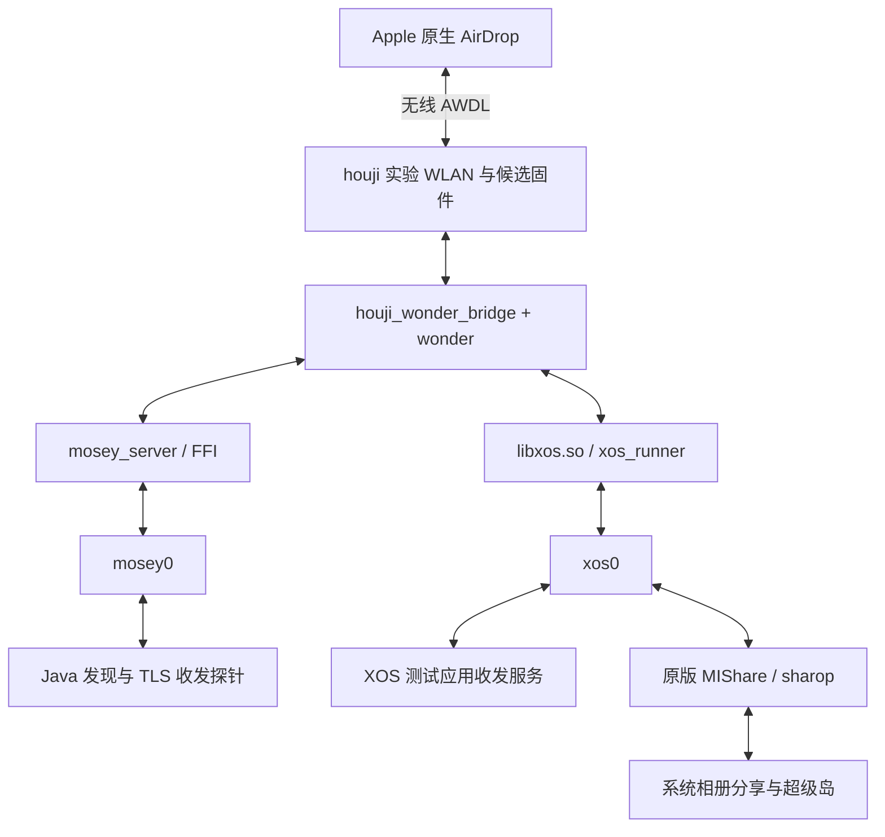

# 架构与两条路线

## 分层

图中是两套可选链路，非并行运行。AWDL 提供无线发现、同步与数据承载；IPv6、mDNS、TLS 和 Discover/Ask/Upload 位于上层。

## 共同驱动底座

houji 使用上游适配的 `qca_cld3_kiwi_v2.ko`、`houji_wonder_bridge.ko`、`wonder.ko` 和候选 `amss20.bin`。这是上游 Release 的预编译组合，**不是直接把 madrid 的 wonder.ko 装到小米 14**。madrid 提取件用于分析和用户态移植。

实验参数 `pt_exclusive=1` 使无线电独占；实际固定信道6 / 2437 MHz，HT20、单空间流。普通 Wi-Fi 的 2.4 GHz、5 GHz 连接都会断开。当前未验证 5 GHz AWDL 或 STA/AWDL 并发。

wonder 提供监控接口和 Vendor nl80211 控制，桥接层连接高通透传路径；用户态通过原始帧接口实现 AWDL，并向上呈现 TAP 接口。内核 owner 的获取、释放和卸载顺序是正确性的组成部分，不能只看接口是否存在。

## 两种用户态的差别

Mosey 使用 One UI 提取的服务及 FFI 库，通过私有挂载命名空间提供依赖，`local-stability.so` 将固定速率降到驱动接受的配置。Java 探针负责上层 AirDrop 协议。

小米 XOS 的 `libxos.so` 从符号、依赖及内部 `OWL_mDNS` 等证据可判断为 OWL 改造实现；这不是已获得小米完整 fork 源码的声明。它创建 xos0，转换 mDNS 与 AWDL Service Response TLV，并维护 IPv6 邻居。原版 MIShare 的 sharop 层负责 TLS 文件传输、UI 和文件提交。

原版 `DomesticXOsComm` 的 Binder 接口由本项目 root `XosBridge.java` 兼容实现，驱动生命周期交给 radio.sh；并非把来源 ROM 的全部 vendor 服务、VINTF 与 init 配置直接安装到 houji。

## 组件来源与提取核实（2026-11-09）

不能将当前无线底座整体写成“三星某机型原版模块”。按上游 `SOURCES.md`、本地拆包记录及 SHA-256 逐项核实如下：

| 组件 | 实际运行版本（大小 / SHA-256 前缀） | 已核实来源与提取路径 |
|---|---|---|
| 候选 `amss20.bin` | `6,426,688` B / `13f01cb4…8709c` | **三星 Galaxy S24 Ultra（`SM-S928B` / 代号 `e3q`，骁龙 8 Gen 3 `kiwi_v2`）固件 `S928BXXS6DZF2`** 的 `vendor/firmware/kiwi/amss20.bin`（从 [`samsung-sm8650/proprietary_vendor_samsung_e3q`](https://github.com/samsung-sm8650/proprietary_vendor_samsung_e3q) 提交 `f749124168e9` / blob `2f0e9d10728e` 提取至 [`dzf2-blob-amss20.bin`](../../downloads/oneui9-houji-analysis/reference-runtime/dzf2-blob-amss20.bin)，与上游 `profiles/runtime-inputs.json` 完全一致） |
| `qca_cld3_kiwi_v2.ko` | `20,305,816` B / `5640700f…5a31`（独立发送版） `20,308,608` B / `5359ad84…9fc0`（framework 版） | 上游 [`YoWenhow/Xiaomi14-PixelOS-Airdrop`](https://github.com/YoWenhow/Xiaomi14-PixelOS-Airdrop) 为 `houji`（`6.1.138-android14-11-g0c3d559bcd85-ab14529422`）编译的预编译模块；基线为 `MiCode/vendor_qcom_opensource_wlan`（`a4da9e3b4386`），合入 115 个覆盖文件（[`kernel/wlan-overlay/`](../../driver/wlan)），其中 `wondertap` / PASSTHRU 兼容代码源自三星与高通公开驱动材料 |
| `houji_wonder_bridge.ko` | `73,664` B / `4acbd949…b7629` | 上游项目专门为 `houji` 编写的桥接模块（[`kernel/bridge/houji_wonder_bridge.c`](../../driver/bridge/main.c)）。因小米 14 原厂内核的 `cnss2` 未导出三星内核特有的 `cnss_set_vendor_wonder_priv_data` 等符号，由该桥接层在 `wonder.ko` 与 `qca_cld3_kiwi_v2.ko` 之间中转 `cnss_wonder_component_ops` 注册、pin/release 与 PASSTHRU 激活 |
| `wonder.ko` | `2,927,768` B / `38079090…67a` | 基于 Google 开源 [`kernel/google-modules/wlan/wonder`](https://android.googlesource.com/kernel/google-modules/wlan/wonder/)（`WONDER_VERSION_1_6_4`），由上游合入 [`kernel/wonder/`](../../driver/wonder) 生命周期与 synthetic provider 适配以对接 `houji_wonder_bridge.ko` |
| Mosey 服务与 FFI | `mosey_server`：`1,492,024` B / `e7a4180b…d10a` `libmosey_daemon_ffi.so`：`2,651,632` B / `d786d7f7…9fd2` `MoseyApp.apk`：`5,143,339` B / `e2d55996…3aae` | 从本地小米 14 One UI 9 移植包（`OneUI 9 - Houji.zip`，基于 **三星 Galaxy S24 Ultra `SM-S928B` One UI 9 构建 `S928BXXU6EZIF`**）的 `system_ext_a.img` 提取至 [`downloads/oneui9-houji-analysis/extracted/`](../../downloads/oneui9-houji-analysis/extracted)；仅用于 Mosey 路线（注：该组二进制与上游 `runtime-inputs.json` 锁定的 Pixel 版本哈希不同，但已通过 `houji` 实机链接与双向收发验证） |
| `libxos.so` / `DomesticXOsComm` / `MIShare.apk` | `libxos.so`：`310,632` B / `156c16fa…bf57` `MIShare.apk`：`29,886,030` B / `b58a24db…a1e7`（`5.4.2_20260923_1315`） | 从 **小米 18 Pro Max（`madrid`，`OS4.0.29.0.XEOCNXM`）** 官方全量包 `super.img`（`vendor_a` 与 `product_a`）按需提取至 [`downloads/madrid-analysis/`](../../downloads/madrid-analysis)；用于小米 XOS 路线 |

### 已提取但未直接装载的对照样本

为避免将不同来源的同名文件混为一谈，以下提取样本仅用于离线逆向与符号对照，**未在 `houji` 上装载运行**：

1. **One UI 9 移植包内的 `qca_cld3_kiwi_v2.ko`**（[`extracted/qca_cld3_kiwi_v2.ko`](../../downloads/oneui9-houji-analysis/extracted/qca_cld3_kiwi_v2.ko)，`20,377,008` B，SHA-256 `d6f2678f…968ae`）：
   - `vermagic=6.1.162-android14-11-34343818-abS928BXXU6EZIF SMP preempt mod_unload modversions aarch64`（对应 `SM-S928B` `S928BXXU6EZIF`）。
   - 虽然与小米 14 原厂 WLAN 模块（[`extracted/stock-houji-wlan.ko`](../../downloads/oneui9-houji-analysis/extracted/stock-houji-wlan.ko)，`19,520,368` B，SHA-256 `156aa260…0684`）共有的 545 个版本化符号 CRC（含 `module_layout = 0xea759d7f`）完全一致，但它额外依赖 **7 个小米 14 运行内核不存在的三星专有符号**（`cnss_get_wlan_tsf_gpio`、`cnss_ipa_wlan_shared_smmu_supported`、`cnss_set_vendor_wonder_priv_data`、`cnss_sysfs_get_pm_info`、`cnss_sysfs_get_pwr_mode_for_rftestmode`、`cnss_sysfs_update_driver_status`、`hdm_is_applied`），因此不能原样 `insmod` 到原厂澎湃 OS 内核。
2. **One UI 9 移植包 `modem.img` 内的 `AMSS20.BIN`**（[`modem.img.amss20.bin`](../../downloads/oneui9-houji-analysis/modem.img.amss20.bin)，`6,447,168` B，SHA-256 `37d40904…b522f`）：
   - 版本串为 `WLAN.HMT.2.0.c3-01013-QCAHMTSWPL_V1.0_V2.0_SILICONZ-1.149480.41.168922.74`，与实机验收使用的 `S928BXXS6DZF2` 固件（`6,426,688` B，`13f01cb4…8709c`）及小米 14 原厂 `NON-HLOS.bin` 固件（`6,365,248` B，`4db7b0e1…bcc8`）均不同。
3. **小米 18 Pro Max（`madrid`）的 `wonder.ko`**（[`downloads/madrid-analysis/wonder.ko`](../../downloads/madrid-analysis/wonder.ko)，`121,480` B，SHA-256 `073e5df0…56b9`）：
   - 仅用于逆向核对 `wondertap` 寄存器/nl80211 vendor subcmd 语义，不适配 `houji` 内核。

依据：[上游来源映射](../../driver/THIRD_PARTY_NOTICES.md)、[外部输入要求](../guides/byob.md)、[上游输入哈希清单](../../driver/sources.json)、[旧交接](../../downloads/oneui9-houji-analysis/AIRDROP-HANDOFF.md)。实机保留小米自身 PHY/BDF 与原厂磁盘模块，只在实验会话临时使用候选 `S928BXXS6DZF2` `amss20.bin`。
