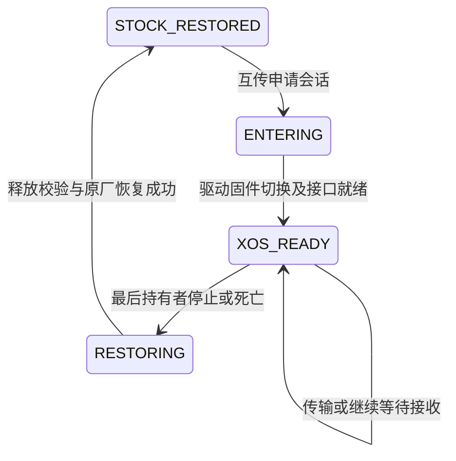

# 运行、Wi-Fi 与恢复

## 当前推荐验证方式

使用原版互传，不同时启动 Mosey 或 XOS 测试应用。手机保持解锁；接收使用“与 Apple 设备互传”页面，发送从系统相册分享入口进入。iPhone 设“所有人（10分钟）”并保持解锁。接收页面锁屏或退出可能主动结束会话。

开始前核对内核、ADB设备、Binder服务、LSPosed两个作用域，以及是否已有传输；不要在活跃传输期间安装兼容 APK、杀进程、替换库或卸载模块。

```sh
adb -s DEVICE_SERIAL shell "su -c 'uname -r; getprop sys.xos.exclusive; service check com.domestic.xoscomm.IDomesticXOsComm/default; ip link show xos0'"
```

接口不存在可能只是空闲未加载，不能单凭此判定失败。当前运行目录 `/data/local/tmp/xos/native`；脚本依赖 `/data/local/tmp/xos` 和历史实验目录，尚不是独立安装包。

## Wi-Fi 生命周期



这表示正常路径，失败必须看日志而非强行跳转。最后持有者释放后延迟2秒恢复，新会话会取消待执行恢复。**单个文件完成并不必然恢复 Wi-Fi**：仍停留接收页面时会话继续。退出会话后自动恢复原厂 Wi-Fi 已实测，包括重新连接此前的5 GHz网络。

radio.sh 保存 Wi-Fi、扫描开关、厂商服务与PCI电源状态。停止runner和wonder接口，释放bridge，确认引用计数和sealed状态，再卸载实验模块、撤销候选固件挂载并校验原厂，最后恢复服务和原设置。不使用强制卸载来跳过检查。

## 排障顺序

| 现象 | 优先检查 |
|---|---|
| 分享入口缺失 | Binder、互传功能检测 hook、重新打开分享面板 |
| 点击入口无反应 | intentresolver 作用域、targetType hook、URI/相册回调日志 |
| 发现中途消失 | Wi-Fi-off竞态、锁屏/onPause、会话被其他测试程序结束 |
| 同名设备重复 | 服务ID、地址、证书是否相同，等待过期；不先改设备名 |
| wonder0 拉起 -95 | 固定速率元组与驱动校验、信道、pt_activate阶段 |
| 传输慢 | TCP及完成事件，分开发现/Ask/上传/落盘耗时 |
| 普通 Wi-Fi 未恢复 | 是否仍有持有者、恢复日志、模块引用和固件校验 |

手工 `radio.sh restore` 只在确认应用会话及测试进程停止后执行；不得与 Binder 启动竞争。Mosey 与 XOS 切换应完整结束旧会话并完成驱动释放，不能仅杀掉一个用户态进程后直接启动另一个。

ADB多条root命令整体引用：`adb shell "su -c 'cmd1; cmd2'"`。避免 adb 重拼参数导致后半段以shell身份执行；不要因这种权限失败增加SELinux授权。

## 最后验证的基线

上一轮测试结束已恢复 STOCK_RESTORED，移除本轮xosperf探针；并非刚刚重新读取的实时状态。

- 标准 runner 为 MCS3，SHA256 `71cbc16dd72eccd21eebd229bd6c09bb31ea3c14d2dc1f2f580a5add6848071a`。
- 标准 libxos 原版 SHA256 `0a1b6401bcbde7d50f1e503b2f581940c6f40d4c3a701a1aa1a03ee04bbfffab`。
- guard12、pace1ms已撤回；MCS7未运行。
- 重启后不能假定服务或live policy仍在。旧 APK/应用数据回滚与无线恢复是不同操作；不要为恢复Wi-Fi随意回退互传数据。
